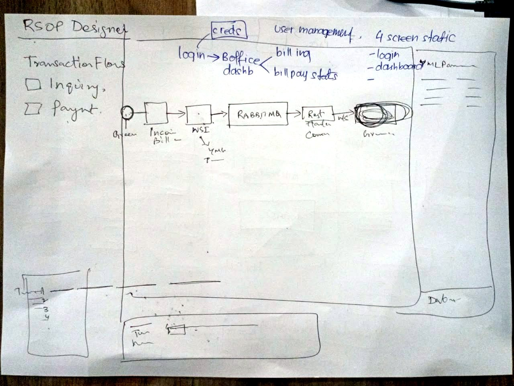

# RSOP Back Office: Executive Summary

## Contents

- [In one minute](#in-one-minute)
- [At a glance](#at-a-glance)
- [What the sketch shows](#what-the-sketch-shows)
- [The four screens](#the-four-screens)
- [How it is built](#how-it-is-built)
- [Delivery phases](#delivery-phases)
- [Decisions applied](#decisions-applied)
- [Risks](#risks)

The full plan is in [details.md](details.md).

## In one minute

- **What.** A first-draft, clickable UI for the RSOP back office, drawn from KJ's HLD sketch. It has four screens: sign-in, a dashboard with bill-pay stats and billing, the RSOP Designer, and user management.
- **For whom.** KJ and the team, so they can agree on screens and behaviour before any backend exists.
- **The core.** The Designer draws the Inquiry and Payment flows as pipelines.
  - The steps come from RSOP's flow API, through a committed snapshot ([api-integration/plan.md](api-integration/plan.md)).
  - The Inquiry keeps KJ's main line: Incoming Bill → WSI → RabbitMQ → REST → WS → government biller.
  - Payment runs as two chains: pacs.008 → AUTH, then ACSP → bill marking.
  - Clicking a step shows its YAML parameters.
  - Picking the sample transaction, "FBR", replays it on the canvas and on a timeline, and a Debug tab shows what passed through each step.
- **Around it.** Sign-in, the dashboard and user management run on mock data. Anything that doesn't need a backend works: filters, search and links between screens.
- **How.** The same procedure and stack as RSOP demo: Astro 7, strict TypeScript, hand-written CSS and no backend. Flows, transactions and figures live in typed data files, `npm run check` guards them, and screenshots cover both themes.

## At a glance

| | |
|---|---|
| **Source of truth** | RSOP's flow API for each flow's steps; KJ's sketch for the screens and the names of the steps it draws; the [Open Connect doc](../../RSOP%20demo/docs/Open_Connect_RAAST_Inquiry_and_Bill_Payment.docx) for how the flows behave |
| **Stack** | Astro 7.3 static site, strict TypeScript, hand-written CSS, vanilla TypeScript for the interactive parts |
| **Backend** | None at run time. Each flow's steps come from a snapshot of RSOP's flow API, which `npm run api:pull` refreshes. Every figure, user, parameter and transaction is mock data in `src/data/` |
| **Location** | `RSOP demo 2/` is the project root; the sketch stays in `pics/` |
| **This draft** | All four screens; both flows, each with one sample transaction, "FBR" |
| **Next** | Fold in KJ's answers, then decide whether the Designer becomes an editor |

## What the sketch shows



The photo is taken sideways; [sketch-upright.jpg](sketch-upright.jpg) is the same photo turned upright. It shows an IDE-style **RSOP Designer**:

```
┌───────────────────┬──────────────────────────────────────────┬───────────────┐
│ RSOP Designer     │                                          │ YML Params    │
│                   │                                          │  key ── value │
│ Transaction Flows │                  CANVAS                  │  key ── value │
│  ☐ Inquiry        │        (selected flow's pipeline)        │  key ── value │
│  ☐ Payment        │                                          │               │
│                   │                                          │               │
├───────────────────┼──────────────────────────────────────────┤               │
│ "T…"  1 2 3 4     │ "Tim…"  [ ]────────────────              │               │
│                   │                                          │ "Dvb…"        │
└───────────────────┴──────────────────────────────────────────┴───────────────┘
```

- The canvas shows a start node → Incoming Bill → WSI (with an arrow to "YML T…") → RabbitMQ → REST ("Header Conv…") → an edge labelled WS → an end node labelled "Gov…".
- Notes along the top add a back office around the Designer: "creds" → login → back-office dashboard, which branches to billing and bill-pay stats. They also list "User management" and "4 screen static".
- Three labels are hard to read: the "T…" box, the "Tim…" strip and "Dvb…". The draft applies a reading for each (see [Decisions applied](#decisions-applied)); [details.md](details.md#3-reading-the-sketch) has the full reading.

## The four screens

| Route | Screen | What it does |
|---|---|---|
| `/` | Sign in | Username and password. Any details take you to the dashboard |
| `/dashboard/` | Dashboard | Bill-pay stats (collected today, payments per hour, the inquiry-to-bill-marked funnel, collected by bill type) and billing: every bill with its payment and bill-marking status |
| `/designer/inquiry/`, `/designer/payment/` | RSOP Designer | The two flows as pipelines, YAML parameters per step, a sample transaction replayed on a timeline, and a Debug tab per step |
| `/users/` | Users | Users with role and status, search, role filter, a role-permission matrix, and an invite dialog that does not send |

## How it is built

- Astro 7.3, strict TypeScript and hand-written CSS. Tokens, fonts and the theme toggle come from RSOP demo, so both demos read as one family. Dark is the default.
- Each flow is a typed data file: its YAML parameters, descriptions and a sample transaction. Its steps and hops are built from the API snapshot. One Astro component draws any flow, and a small vanilla script handles selection, the transaction overlay and the timeline.
- All content is rendered at build time. Without JavaScript, each flow page still shows the pipeline, every step's parameters and every transaction's events.
- `npm run check` runs `astro check` and Node's built-in test runner. The tests check that each flow is a sound graph, that each lane matches its API chain, and that the Inquiry keeps the sketch's blocks in order. They check the transactions against the doc's demo checks, for example that a refused payment never reaches bill marking. They also check that the dashboard's figures add up.
- The charts are plain SVG. Their colours were checked with a colour-vision validator in both themes, and every chart has a table view.

## Delivery phases

| Phase | Scope | Done when |
|---|---|---|
| 0 · Scaffold | Project, tokens, fonts, theme toggle, app header | The empty app runs locally in both themes |
| 1 · First draft | All four screens, both flows, sample transactions | You can click through every screen on desktop and phone, in both themes |
| 2 · Review with KJ | Fold in the answers to the decisions below | KJ recognises the sketch in it |
| 3 · Optional | Designer editing (drag, connect, save YAML), date-range filter, Vercel preview | As you decide |

The working loop is the same as for RSOP demo: I build and share screenshots, you check a local preview, and we iterate.

## Decisions applied

None of these were confirmed. The draft applies the default shown, and each is one change away.

| # | Question | Applied |
|---|---|---|
| 1 | Which are the "4 screen static"? | Sign in, Dashboard, Designer and Users, all on mock data |
| 2 | Designer: editor or viewer? | Viewer. YAML is read-only and the layout is fixed |
| 3 | Stack | Astro, as in RSOP demo. React with React Flow would pay off only if the Designer becomes a drag-and-drop editor |
| 4 | The doc's steps the API does not return | The inquiry store and Rejected, drawn dashed and tagged "From the doc" |
| 5 | The "T…" box with 1–4 | A list of transactions, numbered 1–4 |
| 6 | The "Tim…" strip | A timeline of the selected transaction, with a scrubber |
| 7 | "Dvb…" under the right panel | A Debug tab beside the YAML parameters |
| 8 | "Billing" on the dashboard | The bill ledger (each bill and where it stands), not fee invoicing |
| 9 | `NAUT` or the doc's `NAUTH` | `NAUT`, as in RSOP demo |
| 10 | Branding | Neutral: plain-text names, no logos |
| 11 | Hosting | Local preview only |

## Risks

- **Reading the sketch wrongly.** Three labels are guesses. The Designer marks every step that comes from the doc rather than the sketch, so KJ can spot additions at a glance.
- **A draft that looks finished.** Every screen carries a "Mock data" marker, and YAML values are placeholders, labelled as such.
- **Sketch and doc disagreeing.** The sketch has no validation step or ACSP wait. The draft follows the doc for behaviour and flags the added steps rather than silently redrawing KJ's pipeline.
- **The folder name has a space.** It works for RSOP demo; if a tool breaks on it, rename the folder to `rsop-demo-2`.
